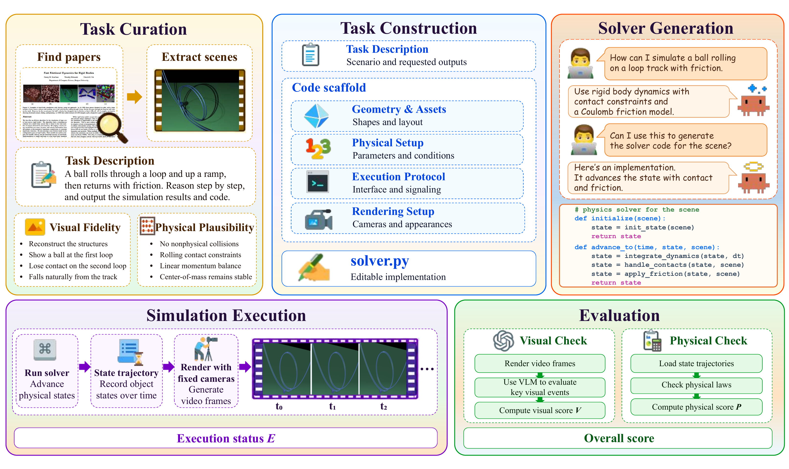

# WorldSolver: Can LLM Agents Simulate the Physical Dynamics via Solver Generation?

WorldSolver is a benchmark for evaluating whether LLM agents can turn descriptions of physical phenomena into executable physics solvers. Building a solver requires physical understanding to select an appropriate model, mathematical reasoning to formulate the dynamics, and software engineering to implement a working numerical procedure.

The benchmark contains **168 simulation tasks** derived from physical phenomena in **61 classic computer graphics papers**, spanning **seven physical domains**: fluid, rigid body, plastic and complex materials, elastic solids, rods and strands, cloth and shells, and multiphysics coupling.

For every task, WorldSolver provides a fixed code scaffold containing the scene geometry and assets, physical setup, execution protocol, and rendering setup. The agent implements only the physics solver. Running the solver produces a state trajectory and a rendered simulation video for evaluation.

## WorldSolver Workflow



Each task begins with a physical phenomenon selected from the computer graphics literature. A task description and fixed scaffold are then provided to an LLM agent, which generates `solver.py`. The solver advances the physical state over time, exports a trajectory, and produces a video through the fixed renderer.

## Evaluation Metrics

- **Execution Checks**: We run each solver under the code scaffold, setting the execution score to 1 if it completes successfully and produces valid output, and to 0 otherwise.
- **Visual Fidelity**: Visual Fidelity measures how well the rendered simulation reproduces the task's target phenomena.
- **Physical Plausibility**: Physical Plausibility verifies whether the generated trajectory respects relevant physical laws and constraints.

## Repository Structure

```text
WorldSolver/
├── task/
│   └── <task-id>/
│       ├── task.yaml                 # task description
│       └── metric.yaml               # evaluation criteria
├── results/
│   └── <task-id>/
│       ├── solvers/<model>.py        # generated solver for each model
│       ├── scene.py                  # scene definition
│       ├── config.yaml               # simulation configuration
│       ├── scene_geometry.yaml       # scene geometry
│       ├── render_spec.yaml          # rendering configuration
│       ├── run.py
│       ├── render.py
│       └── assets/                   # task assets, when required
├── evaluation/
│   └── <task-id>/<model>/
│       └── evaluation.json           # published evaluation result
├── scripts/                           # runtime, rendering, and evaluation code
├── evaluate.py                        # evaluation entry point
└── pyproject.toml
```

## Installation

WorldSolver supports Python 3.11-3.13.

```bash
python -m venv .venv
python -m pip install --upgrade pip
python -m pip install -e .
```

Rendering uses `pyrender` and requires a working OpenGL or EGL environment.

## Evaluation

Visual evaluation uses an OpenAI-compatible multimodal Chat Completions endpoint. Create `visual_judge.yaml` in the repository root and provide the judge model, endpoint, and API key:

```yaml
model: your-vision-model
base_url: https://your-endpoint.example/v1
api_key: your-api-key
```

Run one published solver by specifying its task ID and model name:

```bash
python evaluate.py --task-id 001_2d_dam_break --model gpt-5.6-sol
```

Task IDs are the directory names under `task/`. Model names are the filenames under `results/<task-id>/solvers/`, without the `.py` extension.

The command runs the solver, validates the generated trajectory, renders the simulation, computes the physical metrics, and performs visual evaluation. Visual evaluation samples 20 evenly spaced video frames and repeats the evaluation five times.

Generated files are written to:

```text
outputs/<task-id>/<model>/
├── trajectory.h5
├── video.mp4
└── evaluation.json
```

`evaluation.json` contains criterion-level results together with `visual_fidelity_score`, `physical_plausibility_score`, and `total_score`, all reported on a 0-100 scale. Solver execution has a fixed 600-second wall-clock limit. An execution failure receives zero visual, physical, and total scores.

## Citation

If you use WorldSolver in your research, please cite the accompanying paper. Citation information will be added after the arXiv release.

## License

This repository is released under the [MIT License](LICENSE).
